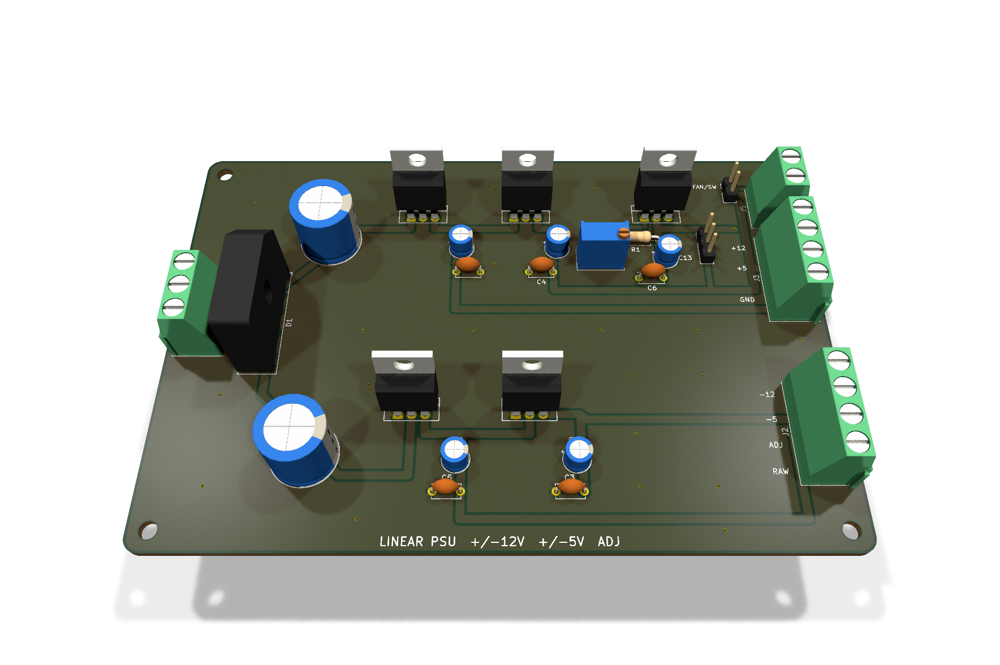
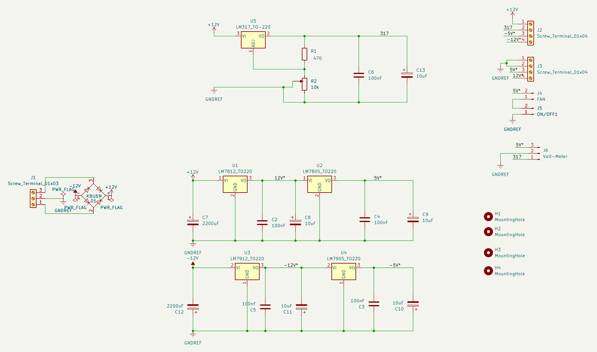
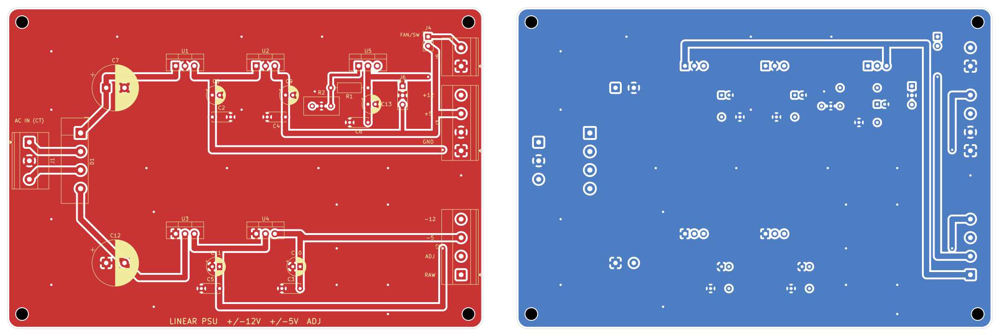

# Multi-Rail Linear Power Supply

A bench power supply with fixed **+12 V, +5 V, −12 V and −5 V** rails plus an
**adjustable LM317 output**, designed in KiCad 10. The schematic is complete and
the two-layer PCB is placed and routed with a clean DRC.



> **Project status: layout complete, not fabricated.** ERC and DRC pass,
> with no unconnected nets and no schematic/PCB mismatches. The board has not
> been ordered or tested. See [Remaining work](#remaining-work).

## Overview

Analogue bench work needs a split supply: op-amp circuits want symmetric ±12 V,
logic wants 5 V, and general prototyping wants an adjustable rail. This design
produces all of them from one centre-tapped transformer using linear regulators,
chosen over a switching topology for low output noise.

## Schematic



| Stage | Parts | Function |
|---|---|---|
| Input | J1 screw terminal | Centre-tapped transformer secondary (CT = ground) |
| Rectification | D1, KBU6M 6 A bridge | Full-wave rectification to ± raw DC |
| Bulk filtering | C7, C12, 2200 µF | One per raw rail, smooths rectifier ripple |
| +12 V | U1, LM7812 | Fed from + raw |
| +5 V | U2, LM7805 | Fed from the +12 V output |
| −12 V | U3, LM7912 | Fed from − raw |
| −5 V | U4, LM7905 | Fed from the −12 V output |
| Adjustable | U5, LM317; R1 = 470 Ω; R2 = 10 k trimmer | Adjustable output |
| Decoupling | 100 nF + 10 µF on each regulator output | Stability and HF bypass |
| Outputs | J3 (+12, +5, GND), J2 (−12, −5, ADJ, raw +) | Screw terminals |
| Extras | J4 fan header, J5 fan switch, J6 panel voltmeter | Cooling and monitoring |

### Adjustable rail range

The LM317 holds 1.25 V across R1, and R2 sets the output:

```
Vout = 1.25 × (1 + R2/R1)
     = 1.25 V (R2 = 0)  to  1.25 × (1 + 10000/470) ≈ 27.8 V (R2 = 10 k)
```

In practice the maximum is limited by the input: the LM317 needs about 3 V of
headroom, so the output can only reach roughly 3 V below the + raw rail.

### Design decisions

- **Cascaded 5 V regulators.** The 7805 and 7905 run from the ±12 V outputs
  rather than from the raw rails, splitting the voltage drop (and heat) across
  two packages.
- **Two-tier decoupling.** 2200 µF bulk capacitors handle rectifier ripple;
  10 µF and 100 nF capacitors at each regulator output handle stability and
  high-frequency bypass.
- **6 A bridge.** KBU6M is rated well above the expected draw, giving headroom
  and lower junction temperature.

## PCB



*Left: top copper and silkscreen. Right: bottom copper.*

- **Board:** 130 × 88 mm, two layers, four M3 mounting holes.
- **Flow:** AC input and bridge on the left. Positive regulators along the top
  edge and negative regulators in the lower half, each with about 12 mm of
  clear space behind its tab for a heatsink. Output terminals on the right
  edge, with wire entries facing out.
- **Copper:** ground planes on both layers with stitching vias. 1.5 mm power
  tracks; only a few short tracks on the bottom layer.
- **Footprints:** all through-hole: TO-220 regulators, radial electrolytics,
  Phoenix MKDS 5.08 mm terminal blocks, and a Bourns 3296W trimmer.

**Heatsink warning:** the regulator tabs are at different potentials (GND on
the 78xx, the input on the 79xx, the output on the LM317). Use a separate
heatsink for each, or insulating pads and washers on a shared one.

## How to Open

1. Install [KiCad 10](https://www.kicad.org/download/).
2. Open `hardware/LinearPowerSupply.kicad_pro`.
3. The schematic opens in Eeschema and the routed board in Pcbnew.

## Remaining Work

1. **Choose the transformer.** Its secondary voltage sets the raw rails,
   regulator dissipation and the LM317's maximum output.
2. **Thermal calculation.** For each regulator, dissipation is
   `(Vin − Vout) × Iout`; size the heatsinks from that.
3. **Protection.** Add an input fuse and bleeder resistors across the bulk
   capacitors.
4. **Generate Gerbers and a BOM**, order boards, build, and test.

## Repository Structure

```
.
├── hardware/
│   ├── LinearPowerSupply.kicad_pro   project file
│   ├── LinearPowerSupply.kicad_sch   schematic
│   └── LinearPowerSupply.kicad_pcb   routed PCB
├── images/
│   ├── 01-schematic.png              schematic export
│   ├── 02-pcb-layout.png             top and bottom copper
│   └── 03-pcb-3d.png                 3D render
└── README.md
```

> **Safety note.** This design rectifies an AC input. The transformer secondary
> and bulk capacitors hold dangerous energy. Do not build it without fusing,
> an enclosure and appropriate precautions.
