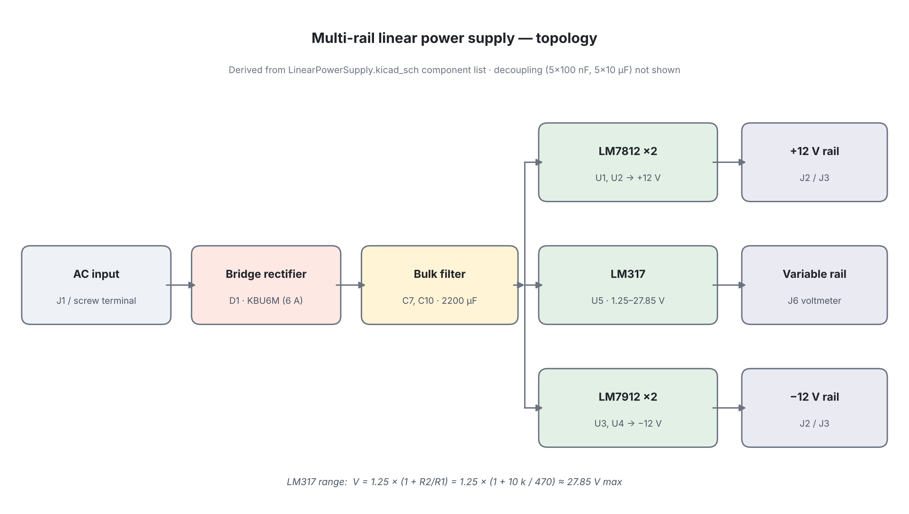
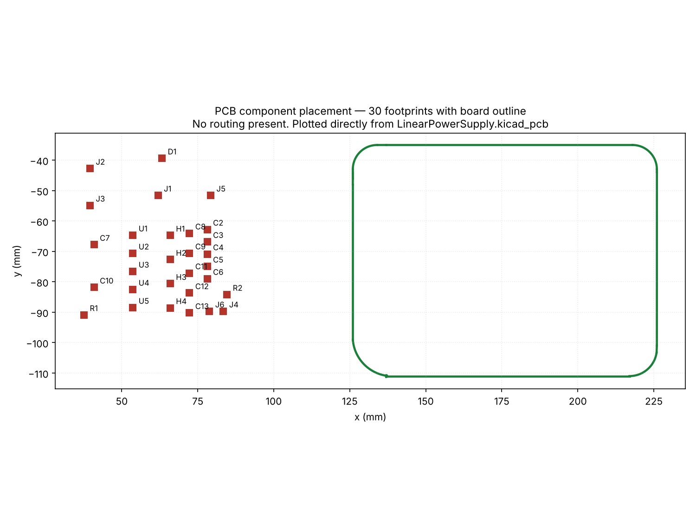

# Multi-Rail Linear Power Supply

A bench power supply providing fixed **+12 V** and **−12 V** rails plus a
**variable 1.25–27.85 V** output, designed in KiCad 10. Schematic capture and
PCB work in progress.

> **Project status: component selection and placement.** The schematic carries
> the full part set but nets are not yet drawn, and the PCB has a board outline
> and imported footprints with no routing. Nothing here has been fabricated.
> See [Current state](#current-state) for specifics.

## Overview

Analogue bench work needs a split supply: op-amp circuits want symmetric ±12 V,
while general prototyping wants an adjustable rail. This design produces all
three from a single transformer input using linear regulators — chosen over a
switching topology for low output noise, which matters when the supply is
feeding measurement and audio-band circuits.

## Topology



| Stage | Parts | Function |
|---|---|---|
| Input | J1 screw terminal | AC from external transformer |
| Rectification | D1 — KBU6M, 6 A bridge | Full-wave rectification |
| Bulk filtering | C7, C10 — 2200 µF | Smooths rectified ripple |
| +12 V | U1, U2 — LM7812 | Two fixed positive regulators |
| −12 V | U3, U4 — LM7912 | Two fixed negative regulators |
| Variable | U5 — LM317, R1 = 470 Ω, R2 = 10 k | Adjustable output |
| Decoupling | 5 × 100 nF, 5 × 10 µF | Regulator stability, HF bypass |
| I/O | J2, J3, J4 screw terminals; J5 ON/OFF; J6 voltmeter; J4 fan | Connections and monitoring |

### Variable rail range

The LM317 holds 1.25 V across its adjustment divider:

```
Vout = 1.25 × (1 + R2/R1)
     = 1.25 × (1 + 10000/470)
     = 27.85 V maximum,  1.25 V minimum
```

### Design decisions

- **Paired fixed regulators.** Two LM7812 and two LM7912 rather than one of each,
  spreading current across packages and limiting per-device dissipation — the
  practical constraint in a linear supply, where the regulator drops the
  difference between rectified input and output as heat. The fan header (J4)
  serves the same concern.
- **Two-tier decoupling.** 2200 µF bulk capacitors handle rectifier ripple;
  10 µF and 100 nF local capacitors handle regulator stability and
  high-frequency bypass, which the bulk electrolytics are too slow to cover.
- **6 A bridge.** KBU6M is rated well above the expected draw, giving headroom
  and lower junction temperature.
- **Panel provisions.** Voltmeter and ON/OFF headers plus four mounting holes
  indicate this was designed for enclosure mounting rather than bench-top use.

## Current state

Verified by inspecting the project files directly:

| Item | Status |
|---|---|
| Components selected | 42 symbols placed in the schematic |
| Schematic nets | **Not drawn** — 0 wires, 0 junctions; 13 net labels and 13 power symbols placed |
| Board outline | Drawn — 100 × 76 mm, rounded corners |
| Footprints | 30 imported |
| Footprint placement | **Not placed** — footprints sit beside the board outline, not on it |
| Routing | **None** — 0 tracks, 0 vias, 0 copper zones, 0 nets |
| ERC / DRC | Not run |
| Fabrication | Not fabricated |



*Plotted directly from `LinearPowerSupply.kicad_pcb`. The footprint cluster to
the left is the imported set awaiting placement on the outlined board.*

The schematic also carries net labels `5V*` and `−5V*` with no corresponding
regulator, suggesting a 5 V rail was planned but not started.

## Technologies Used

- **KiCad 10.0** — schematic capture (Eeschema) and PCB layout (Pcbnew)
- Linear regulators: LM7812, LM7912, LM317
- Through-hole construction, TO-220 regulator packages

## How to Open

1. Install [KiCad 9 or later](https://www.kicad.org/download/).
2. Open `hardware/LinearPowerSupply.kicad_pro`.
3. Eeschema shows the schematic; Pcbnew shows the board outline and footprints.

## Remaining Work

Roughly in order:

1. **Wire the schematic.** Draw the nets; labels alone do not establish connectivity.
2. **Run ERC** and resolve unconnected pins.
3. **Add the transformer secondary spec** — input voltage drives regulator dissipation and heatsink sizing.
4. **Thermal calculation.** For the LM317 at minimum output and full load, dissipation is `(Vin − 1.25) × Iout`, which sets the heatsink requirement. This is the main design risk in a linear supply.
5. **Place footprints on the board** and route, with wide traces on the rectifier and bulk-capacitor paths.
6. **Add a ground pour** and run DRC.
7. **Protection** — fuse on the input, reverse-polarity protection, bleeder resistors across the bulk capacitors.
8. Generate Gerbers and a BOM.

## Repository Structure

```
.
├── hardware/
│   ├── LinearPowerSupply.kicad_pro   project file
│   ├── LinearPowerSupply.kicad_sch   schematic
│   └── LinearPowerSupply.kicad_pcb   board outline and footprints
├── images/
│   ├── 01-topology.png               block diagram
│   └── 02-pcb-placement.png          placement snapshot
└── README.md
```

> **Safety note.** This design rectifies an AC input directly. If built, the
> transformer secondary and bulk capacitors hold dangerous energy. Do not
> construct it without appropriate precautions, fusing, and enclosure.
